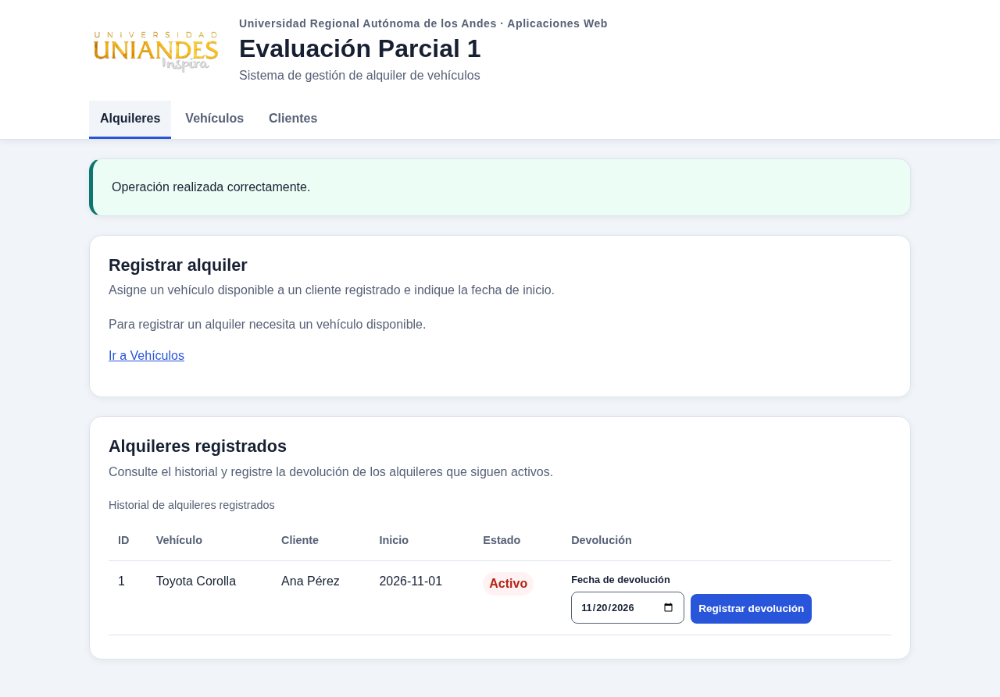
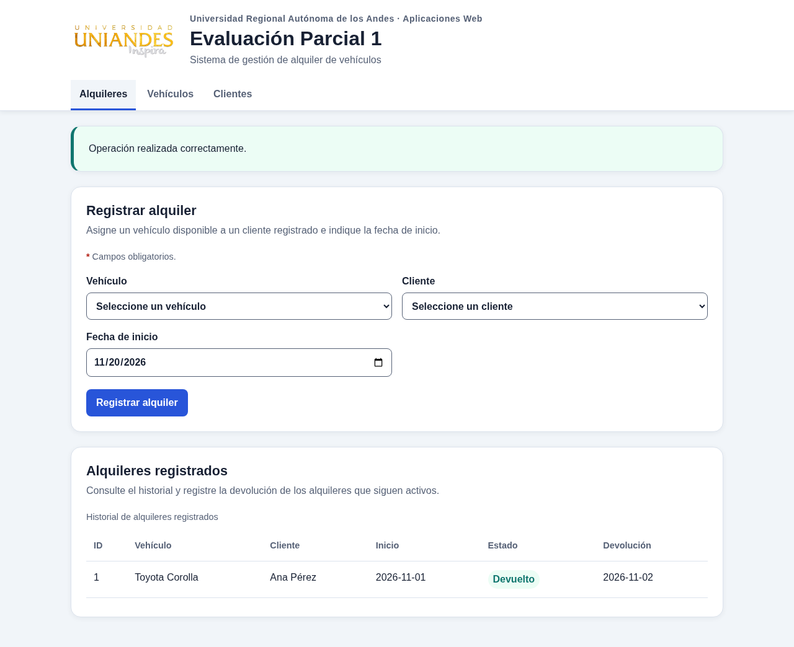

# Evaluación Parcial 1 — Alquiler de vehículos

Sistema académico en **PHP 8.5, Apache y MySQL 8.4** para gestionar vehículos, clientes, alquileres y devoluciones. No requiere frameworks ni dependencias externas.

## Ejecutar

Desde este directorio, con Docker y Docker Compose instalados:

```bash
docker compose up -d --build --wait
```

Abrir **http://127.0.0.1:8083**. MySQL está disponible en `127.0.0.1:3309`, con base y usuario `evaluacion`. Las claves de `compose.yaml` son valores públicos de desarrollo local, no credenciales de producción.

El esquema se crea automáticamente cuando MySQL inicializa un volumen nuevo. Si el entorno ya estaba creado con la página inicial, aplicar las tablas sin borrar datos:

```bash
docker compose exec -T mysql sh -c 'MYSQL_PWD="$MYSQL_ROOT_PASSWORD" mysql --default-character-set=utf8mb4 -uroot evaluacion' < database/schema.sql
```

Detener conservando los datos:

```bash
docker compose down
```

## Uso

1. En **Vehículos**, registrar marca, modelo, año y disponibilidad. Se pueden editar y eliminar vehículos sin alquileres asociados.
2. En **Clientes**, registrar nombre, apellido, licencia y teléfono. La licencia es única. Se pueden editar y eliminar clientes sin alquileres asociados.
3. En **Alquileres**, elegir un cliente y un vehículo disponible e indicar la fecha de inicio.
4. Registrar la devolución con una fecha igual o posterior al inicio. El vehículo vuelve a estar disponible.

La base inicia vacía: primero registrar vehículos y clientes. Los datos se mantienen en el volumen propio del proyecto.

## Identidad y accesibilidad

La cabecera utiliza el logotipo institucional local de UNIANDES. La interfaz incluye un enlace para saltar al contenido principal, foco visible para teclado, pestañas de módulo con estado activo, instrucciones en los formularios y regiones de tabla desplazables en pantallas estrechas.

## Capturas del funcionamiento

Capturas reales del navegador durante el uso del sistema local, con datos de demostración.

| Vista | Captura |
| --- | --- |
| Registro y listado de vehículos | [Vehículos](docs/capturas/vehiculos.png) |
| Registro y listado de clientes | [Clientes](docs/capturas/clientes.png) |
| Alquiler registrado y activo | [Alquiler activo](docs/capturas/alquiler-activo.png) |
| Devolución registrada | [Devolución](docs/capturas/devolucion.png) |
| Presentación en pantalla móvil | [Vista móvil](docs/capturas/vista-movil.png) |





## Tablas

| Tabla | Campos |
| --- | --- |
| `Vehiculos` | `vehiculo_id`, `marca`, `modelo`, `año`, `disponible` |
| `Clientes` | `cliente_id`, `nombre`, `apellido`, `licencia`, `telefono` |
| `Alquileres` | `alquiler_id`, `vehiculo_id`, `cliente_id`, `fecha_inicio`, `fecha_devolucion` |

`Alquileres.vehiculo_activo` es una columna técnica generada: su índice único impide dos alquileres activos para el mismo vehículo. Las claves foráneas conservan el historial: no se eliminan vehículos ni clientes con alquileres asociados, aunque ya estén devueltos.

## Organización

- `public/`: entrada web, formularios y recursos de presentación.
- `src/`: conexión PDO, validación y operaciones transaccionales.
- `database/schema.sql`: tablas, relaciones y restricciones.
- `Dockerfile` y `compose.yaml`: entorno local reproducible.

## Reglas de funcionamiento

- Año entre 1886 y 2100; disponibilidad `0` o `1`.
- Nombres, marca y modelo de hasta 80 caracteres; licencia de hasta 40; teléfono de 7 a 25 caracteres, con al menos 7 dígitos.
- Un vehículo no disponible no admite alquileres nuevos.
- El alquiler y el cambio de disponibilidad se guardan en una transacción con bloqueo del vehículo.
- La devolución también es transaccional y no puede repetirse.
- Las consultas usan parámetros preparados; las páginas escapan los datos y los formularios verifican su sesión antes de modificar registros.
- Si un formulario es rechazado, se muestra el motivo y se conservan sus valores.

Entorno académico **solo local**, sin autenticación ni despliegue público. Los servicios se publican exclusivamente en la interfaz de loopback.
