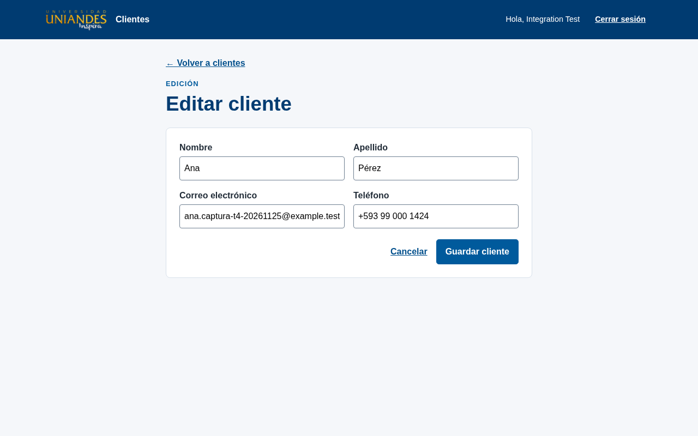

# Semana 5 — Clientes Angular y autenticación PHP

CRUD de clientes con sesión por cookie, para práctica local con Docker; no es una
configuración lista para producción.

## Inicio rápido
```bash
docker compose up --build
```
Abrí [http://localhost:8086](http://localhost:8086). nginx entrega Angular y
reenvía `/api` al contenedor PHP en el mismo origen. La API queda sólo en
`127.0.0.1:8085`. Para detenerlo: `docker compose down`.

## Crear una cuenta local
No hay usuarios, contraseñas personales ni credenciales de inicio preconfiguradas.
En una terminal Bash, elegí tu correo y nombre y ejecutá:
```bash
read -rs -p 'Contraseña (mínimo 12 caracteres): ' PASSWORD; printf '\n'
if [ "${#PASSWORD}" -lt 12 ]; then
  echo 'La contraseña debe tener al menos 12 caracteres.' >&2
else
  printf '%s\n' "$PASSWORD" | docker compose exec -T api php crear-usuario.php \
    "tu.correo@example.test" "Tu Nombre"
fi
unset PASSWORD
```
`read -rs` evita que la clave se muestre; `printf` la pasa por entrada estándar.
No la pongas como argumento, en el historial ni en archivos versionados.

## Sesión y alcance de seguridad
- `UNIANDES_SESSION` es HttpOnly; `XSRF-TOKEN` es legible para el encabezado
  XSRF de Angular. Ningún token se guarda en `localStorage`.
- El login regenera la cookie de sesión; la inactividad vence con
  `SESSION_TTL=1800` segundos por defecto.
- La base usa valores públicos, desechables y sólo locales (loopback). No son
  secretos reales ni credenciales de producción.
- En HTTPS de producción, configurá `COOKIE_SECURE=1`, usá credenciales
  administradas externamente y un terminador TLS. Este repositorio no afirma
  estar listo para producción.

## Estructura docente
```text
frontend/src/app/
├── interfaces/    # modelos
├── services/      # HTTP y estado de autenticación
├── components/    # login y tabla/formulario de clientes
├── guards/        # rutas con sesión
└── interceptors/  # credenciales y errores
```
La rúbrica menciona .NET; esta entrega adapta esas responsabilidades a PHP:
API separada, sesión, validación y respuestas HTTP; Angular usa servicios,
interceptor, guard y formularios reactivos.

## Herramientas y pruebas
Se requiere Docker Compose. El frontend usa Node 26, Angular 22.3.0 y pnpm
12.14. Comprobación aislada de API:
```bash
./tests/run.sh
```
Opcionalmente, con Node 26 en el host:
```bash
cd frontend
pnpm install
pnpm build
pnpm test
```
La colección manual está en [tests/requests.http](tests/requests.http). Se
observaron 9 pruebas Angular y 4 HTTP verdes. La demostración breve está en
[demo](docs/demo.webm).

## Capturas

**Inicio de sesión.** Acceso con identidad visual institucional y campos vacíos.


**Lista de clientes.** Tabla de registros con las acciones disponibles.


**Formulario.** Edición de un registro ficticio con validación reactiva.



**Vista móvil.** La lista se adapta a una pantalla de 390 px de ancho.


## Referencia de clase
Adaptado del instructor, commit
[`53e41773adf2ae0f218119dd690e5a6bed2a8c52`](https://github.com/lleroc/Sexto_OM26/tree/53e41773adf2ae0f218119dd690e5a6bed2a8c52/Semana%205),
rutas `Semana 5/backend/{api,cliente,conexion}.php`: conserva CRUD `mysqli` y
extiende autenticación y protección de sesión para esta práctica.
