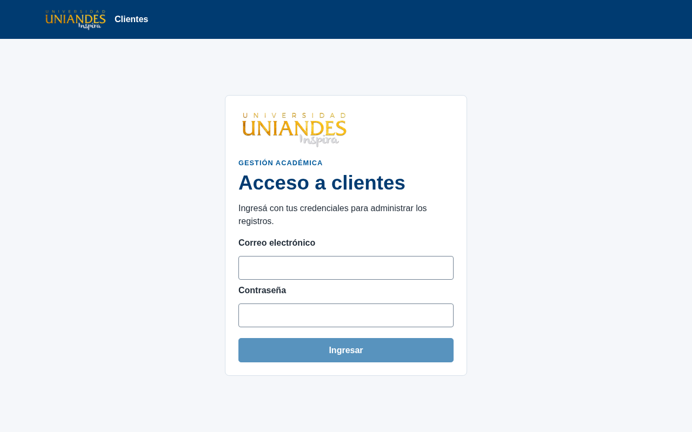
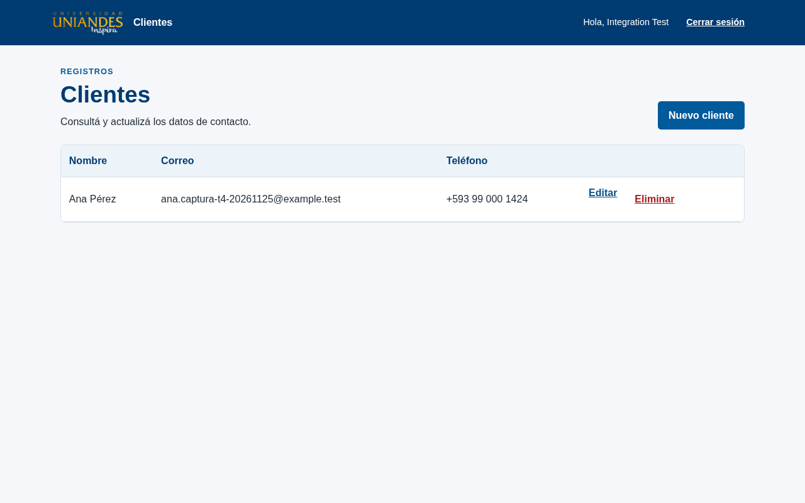
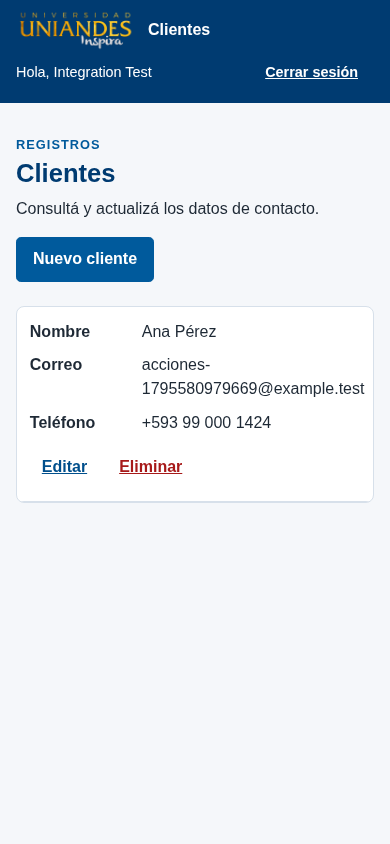

<p align="center">
  
</p>

# Semana 5 — Clientes Angular y autenticación PHP

[Volver al portafolio](../README.md)

CRUD completo de clientes con **Angular 22.3.0, Node 26 y pnpm 12.14**;
API PHP y MariaDB en Docker Compose. El foco está en **interfaces, servicios y
componentes**: listar, crear, editar y eliminar clientes después de iniciar sesión.
Práctica académica local; no es una configuración lista para producción.

## Inicio rápido
Se requiere Docker con Compose; Node y pnpm se ejecutan dentro de la imagen de
construcción. Desde la raíz del repositorio:
```bash
cd seman5
docker compose up -d --build --wait
```
Creá una cuenta con el paso siguiente y abrí
[http://localhost:8086](http://localhost:8086). nginx sirve Angular y reenvía
`/api/` a PHP en el mismo origen. La API también está disponible en
`http://127.0.0.1:8085`; MariaDB no publica un puerto en el host.
Para detenerlo: `docker compose down`, conservando el volumen de datos.

| Variable de Compose | Valor predeterminado | Uso |
|---|---|---|
| `WEB_PORT` | `8086` | Acceso al frontend |
| `API_PORT` | `8085` | Acceso directo a la API |
| `SESSION_TTL` | `1800` | Segundos de inactividad antes de vencer la sesión |
| `COOKIE_SECURE` | `0` | HTTP local; usar `1` cuando se sirva mediante HTTPS |

## Crear una cuenta local
No hay usuarios, contraseñas personales ni credenciales de inicio preconfiguradas.
En una terminal Bash, elegí tu correo y nombre y ejecutá:
```bash
read -rs -p 'Contraseña (mínimo 12 caracteres): ' PASSWORD; printf '\n'
if [ "${#PASSWORD}" -lt 12 ]; then
  echo 'La contraseña debe tener al menos 12 caracteres.' >&2
else
  printf '%s\n' "$PASSWORD" | docker compose exec -T api php crear-usuario.php \
    "tu.correo@example.test" "Tu Nombre"
fi
unset PASSWORD
```
`read -rs` evita que la clave se muestre; `printf` la pasa por entrada estándar.
No la pongas como argumento, en el historial ni en archivos versionados.

## Sesión y alcance de seguridad
- `UNIANDES_SESSION` es HttpOnly; `XSRF-TOKEN` es legible para el encabezado
  XSRF de Angular. Ningún token se guarda en `localStorage`.
- El login regenera la cookie de sesión; la inactividad vence con
  `SESSION_TTL=1800` segundos por defecto.
- La base usa valores públicos, desechables y sólo locales (loopback). No son
  secretos reales ni credenciales de producción.
- En HTTPS de producción, configurá `COOKIE_SECURE=1`, usá credenciales
  administradas externamente y un terminador TLS. Este repositorio no afirma
  estar listo para producción.

## Estructura docente
```text
frontend/src/app/
├── interfaces/    # Cliente, ClienteInput, Usuario y respuestas de sesión
├── services/      # ClienteService: CRUD; AuthService: sesión y login/logout
├── components/    # Login, listado y formulario reactivo de clientes
├── guards/        # Consulta de sesión antes de entrar a /clientes
└── interceptors/  # withCredentials y redirección cuando la API responde 401
```
Las interfaces tipan los datos; los servicios concentran las peticiones HTTP;
los componentes presentan los estados de carga, validación y errores. El CRUD
usa `GET`, `POST`, `PUT` y `DELETE` sobre `/api/api.php`.
La rúbrica menciona .NET; esta entrega conserva PHP según el ejemplo del docente,
con API separada, sesión, validación y respuestas HTTP.

## Herramientas y pruebas
Desde `seman5/`, la comprobación HTTP crea y elimina su propio entorno aislado;
no usa los datos del entorno normal:
```bash
./tests/run.sh
```
Opcionalmente, con Node 26 en el host:
```bash
cd frontend
pnpm install --frozen-lockfile
pnpm test --watch=false
pnpm build
```
La colección manual está en [tests/requests.http](tests/requests.http). Se
verificaron 9 pruebas Angular, 4 HTTP, el build y el flujo de navegador:
login, CRUD, restauración de sesión y logout. [Ver demo breve](docs/demo.webm).
Las capturas usan datos ficticios, eliminados después de la toma.

## Capturas

**Inicio de sesión.** Acceso con identidad visual institucional y campos vacíos.



**Lista de clientes.** Tabla de registros con las acciones disponibles.



**Formulario.** Edición de un registro ficticio con validación reactiva.


**Vista móvil.** La lista se adapta a una pantalla de 390 px de ancho.



## Referencia de clase
Adaptado del instructor, commit
[`53e41773adf2ae0f218119dd690e5a6bed2a8c52`](https://github.com/lleroc/Sexto_OM26/tree/53e41773adf2ae0f218119dd690e5a6bed2a8c52/Semana%205),
rutas `Semana 5/backend/{api,cliente,conexion}.php`: conserva CRUD `mysqli` y
extiende autenticación y protección de sesión para esta práctica.
