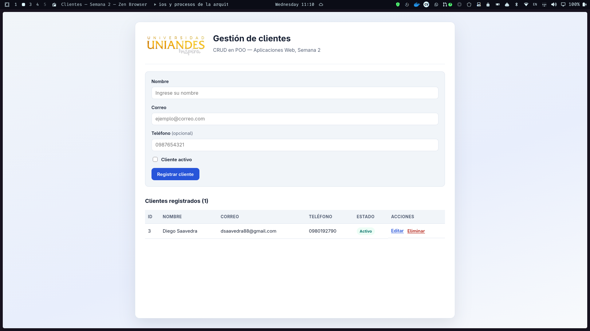
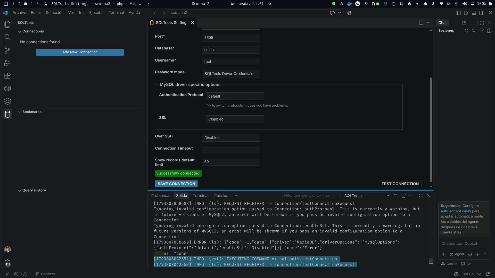
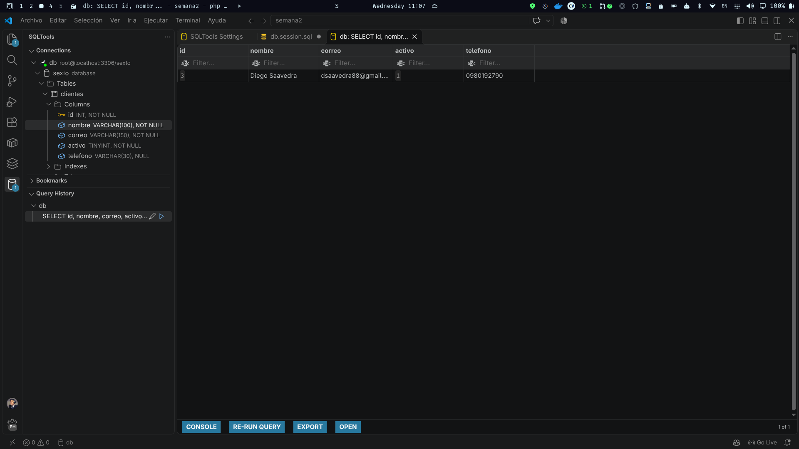

<p align="center">
  
</p>

# Semana 2 — CRUD de clientes con PHP y MariaDB

Aplicación de **Aplicaciones Web** que utiliza programación orientada a objetos para registrar, consultar, actualizar y eliminar clientes. PHP y MariaDB se ejecutan en Docker Compose; la interfaz conserva la marca institucional UNIANDES.

## Ejecutar

Requisitos: Docker y Docker Compose. Desde la raíz del repositorio:

```bash
cd semana2
docker compose up --build -d
```

Abrir **http://localhost:8080**. Para detener los servicios sin eliminar los datos:

```bash
docker compose down
```

Los datos se conservan en el volumen `db_datos`. El script `docker/initdb/01-esquema.sql` crea la tabla al inicializar un volumen nuevo; no se vuelve a ejecutar automáticamente sobre uno existente. No utilizar `docker compose down -v` si se necesitan conservar los registros.

## Usar el CRUD

| Operación | Acción en la interfaz | Comprobación |
|---|---|---|
| Crear | Completar nombre y correo; teléfono y estado son opcionales. Pulsar **Registrar cliente**. | El nuevo cliente aparece en la tabla. |
| Consultar | Abrir la página. | La tabla muestra los clientes almacenados. |
| Actualizar | Pulsar **Editar**, modificar datos y luego **Guardar cambios**. | La fila refleja los valores nuevos. |
| Eliminar | Pulsar **Eliminar** en la fila correspondiente. | El cliente deja de aparecer; la eliminación es permanente. |

El servidor rechaza nombres vacíos, correos inválidos e identificadores de edición que no sean enteros positivos (por ejemplo, `abc`, `1foo`, `0` o `-1`). Un ID de edición inválido muestra **El identificador del cliente no es válido.** sin seleccionar otro cliente. La salida HTML se escapa y el repositorio MariaDB utiliza consultas preparadas. Después de una operación exitosa se redirige al listado para evitar repetir el envío al recargar.

## Verificar desde SQLTools

Instalar las extensiones **SQLTools** y **SQLTools MySQL/MariaDB/TiDB** en VS Code y crear una conexión MariaDB:

| Campo | Valor de desarrollo predeterminado |
|---|---|
| Server / Host | `127.0.0.1` |
| Port | `3306` |
| Database | `sexto` |
| Username | `root` |
| Password | `root` (o el valor de `DB_PASS` configurado) |

Pulsar **Test Connection** y guardar la conexión. Desde PHP, el servidor de base de datos es `db`, el nombre del servicio Docker; desde VS Code, se usa `127.0.0.1` y el puerto publicado.

> Entorno académico local, no una configuración de producción: las credenciales predeterminadas son de desarrollo, no hay autenticación de usuarios en el CRUD y Compose publica `8080` y `3306` en todas las interfaces. No exponer estos servicios a redes no confiables.

### Consultas de comprobación (solo lectura)

```sql
-- Ver los registros más recientes: comparar con el listado del CRUD.
SELECT id, nombre, correo, activo, telefono
FROM sexto.clientes
ORDER BY id DESC;

-- Comprobar la cantidad actual de registros.
SELECT COUNT(*) AS total_clientes
FROM sexto.clientes;

-- Comprobar la estructura utilizada por el repositorio.
DESCRIBE sexto.clientes;
```

Después de crear o actualizar un cliente desde la web, volver a ejecutar el primer `SELECT`: debe aparecer con los valores guardados. Después de eliminarlo, no debe aparecer. Un resultado aislado acredita el estado actual, no demuestra por sí solo las cuatro operaciones.

Si no hay conexión, comprobar la publicación del puerto:

```bash
docker compose ps
```

Para usar un usuario distinto de `root` en una base nueva, configurar `DB_USER` y `DB_PASS` al levantar Compose. El script `docker/initdb/02-usuario.sh` crea ese usuario y le concede acceso a la base configurada. Solo se aplica al inicializar un volumen nuevo: cambiar estas variables no modifica las cuentas de un volumen existente. No borrar el volumen para cambiar credenciales; aprovisionar la cuenta existente de forma administrada.

El servicio `db` debe mostrar el mapeo hacia `3306`. Si el archivo Compose lo declara pero el contenedor activo no lo tiene aplicado:

```bash
docker compose up -d --no-deps --force-recreate db
```

Esto recrea solo el contenedor de MariaDB y conserva su volumen; interrumpe brevemente la conexión. Las advertencias de SQLTools sobre `authProtocol` y `enableSsl` no impidieron la conexión verificada en esta entrega.

## Evidencias de ejecución

Capturas tomadas por el autor el **4 de noviembre de 2026**, conservadas en `docs/evidencias/`. Reflejan los datos presentes al capturarlas; no son registros precargados ni pruebas automatizadas.

### 1. Interfaz del CRUD con identidad UNIANDES

Formulario de registro, cliente almacenado y acciones **Editar** y **Eliminar**. Fuente: `screenshot-2026-11-04_11-10-43.png`.



### 2. Conexión exitosa a MariaDB

SQLTools muestra **Successfully connected!** para la base `sexto`. Fuente: `screenshot-2026-11-04_11-01-23.png`.



### 3. Datos persistidos consultados con SQL

El resultado del `SELECT` muestra el cliente con ID `3`, coincidente con el listado web. Fuente: `screenshot-2026-11-04_11-07-14.png`.



## Pruebas

Las pruebas unitarias no necesitan base de datos. La comprobación de configuración requiere Docker Compose y Python 3:

```bash
php tests/run.php
bash tests/compose-env.sh
```

También pueden ejecutarse dentro del contenedor PHP:

```bash
docker compose exec -T web php tests/run.php
```

Cubren la entidad, los cinco métodos del repositorio en memoria, la validación y los IDs de edición, conservando el caso válido. La comprobación de Compose verifica credenciales coincidentes para `root` y un usuario personalizado.

### Prueba de navegador en estado aislado

`tests/e2e.js` comprueba crear, consultar, actualizar, eliminar, correo inválido, salida XSS escapada, IDs malformados y logo institucional. **Ejecutar únicamente contra una base de prueba nueva y vacía**, nunca sobre los registros de la entrega. El script rechaza un listado inicialmente no vacío y espera que el primer ID sea `1`.

Con un stack de prueba separado ya iniciado, definir `CRUD_TEST_URL` con su URL local y `PLAYWRIGHT_CONFIG` con la configuración del navegador instalado:

```bash
playwright-cli -s=crud-proof open "$CRUD_TEST_URL" --config="$PLAYWRIGHT_CONFIG"
playwright-cli -s=crud-proof run-code --filename=tests/e2e.js
playwright-cli -s=crud-proof close
```

En esta estación se utiliza Chromium con `executablePath` configurado a `/usr/bin/chromium`. Las pruebas unitarias no sustituyen esta comprobación de navegador y MariaDB.

## Organización y conceptos de POO

```text
semana2/
├── index.php                          # Entrada y composición de la aplicación
├── models/Cliente.php                 # Entidad con propiedades tipadas
├── models/ValidadorClientes.php        # Reglas de nombre y correo
├── interfaces/RepositorioClientes.php  # Contrato de persistencia
├── repositories/                      # Adaptadores de memoria y MariaDB
├── controllers/ClienteController.php  # Acciones HTTP y redirección PRG
├── views/clientes.php                 # Formulario y listado escapados
├── config/database.php                # Conexión mediante variables de entorno
├── docker/initdb/01-esquema.sql        # Esquema inicial
├── docs/evidencias/                    # Capturas del CRUD y de SQLTools
├── tests/run.php                       # Pruebas unitarias
├── logo-uniandes.png / favicon.png     # Identidad institucional
├── style.css
├── Dockerfile
└── compose.yaml
```

La interfaz `RepositorioClientes` define `registrar`, `consultar`, `listar`, `actualizar` y `eliminar`. El controlador depende de ese contrato: el adaptador en memoria facilita las pruebas y `ClienteRepositorioMysql` persiste los datos de la aplicación web. Se aplican clases, objetos, tipos, encapsulación y separación de responsabilidades.

## Referencias y autor

- Consigna: **Semana 2 — crear el objeto Cliente y los métodos del CRUD utilizando POO**.
- Referencia del docente: [lleroc/Sexto_OM26 — Semana2](https://github.com/lleroc/Sexto_OM26/tree/main/Semana2).
- Identidad institucional: [UNIANDES](https://www.uniandes.edu.ec/) y [referencia de marca](https://brandfetch.com/uniandes.edu.ec?view=library&library=default&collection=fonts). Los activos existentes provienen del sitio institucional; no se afirma haber validado la tipografía de Brandfetch.

**Diego Saavedra** — Aplicaciones Web, 2026.
