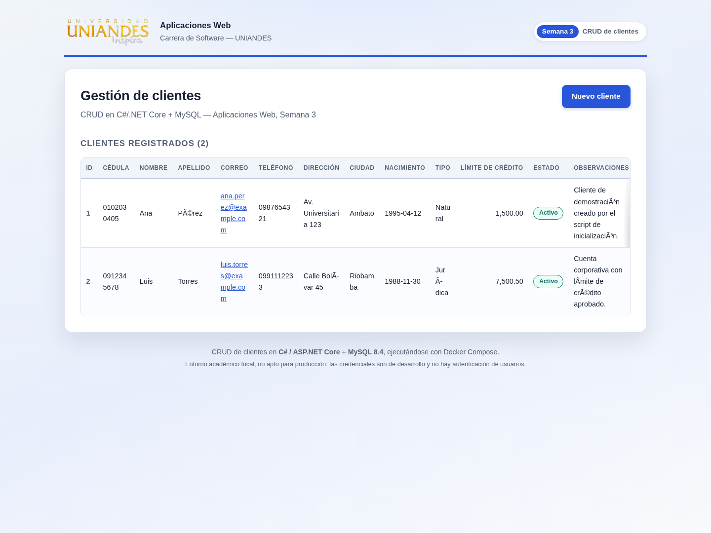
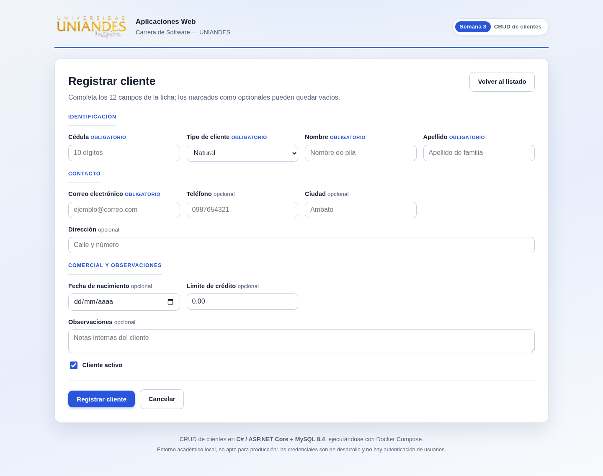

<p align="center">
  
</p>

# Semana 3 — CRUD web de clientes con C# y MySQL

Aplicación académica de **Aplicaciones Web** desarrollada con **ASP.NET Core MVC (.NET 10)**, vistas Razor y **MySQL 8.4**, ejecutada con Docker Compose. Implementa crear, consultar, actualizar y eliminar clientes con **12 campos de negocio**, superando el mínimo de 10 solicitado.

## Ejecutar

Requisitos: Docker y Docker Compose. Desde la raíz del repositorio:

```bash
cd semana3
docker compose up --build -d --wait
```

Abrir **http://localhost:8081**. Consultar la salud con `curl -f http://localhost:8081/health` y los contenedores con `docker compose ps`.

Para detener sin borrar datos:

```bash
docker compose down
```

MySQL se publica en `127.0.0.1:3307` desde el host y la aplicación lo alcanza mediante el servicio `db:3306`. La base es `semana3`. Las variables de configuración son `DB_HOST`, `DB_PORT`, `DB_NAME`, `DB_USER` y `DB_PASS`; no publicar credenciales personales. El volumen lógico `db_datos` conserva los registros. Los scripts de `docker/initdb/` crean esquema, semilla y usuario **solo al inicializar un volumen nuevo**. No usar `down -v` para reiniciar la aplicación: elimina los datos.

> Entorno académico local, no de producción. El CRUD no tiene autenticación de usuarios; por ello Compose publica web y MySQL únicamente en `127.0.0.1`, no en otras interfaces de red.

## Usar las cuatro operaciones

| Operación | Ruta / acción | Resultado esperado |
|---|---|---|
| Crear | **Nuevo cliente**, completar el formulario y pulsar **Registrar cliente**. | El registro aparece en el listado. |
| Consultar | Abrir `/`. | Se muestran los registros y su cantidad. |
| Actualizar | **Editar**, cambiar valores y **Guardar cambios**. | Los cambios aparecen en la misma fila. |
| Eliminar | **Eliminar** y aceptar la confirmación. | La fila desaparece; la operación es permanente. |

El servidor valida los datos, muestra errores en español y redirige al listado después de una modificación exitosa (POST/Redirect/GET). Las operaciones POST incluyen protección antifalsificación. Los IDs inválidos como `abc`, `1foo`, `0` y `-1` muestran **El identificador del cliente no es válido.**

## Los 12 campos

`Id` es una clave primaria autoincremental adicional, no uno de los 12 campos de negocio.

| Campo del formulario | Tipo SQL | Entrada |
|---|---|---|
| Cédula | `VARCHAR(15)` | Obligatoria y única |
| Nombre | `VARCHAR(100)` | Obligatorio |
| Apellido | `VARCHAR(100)` | Obligatorio |
| Correo | `VARCHAR(150)` | Obligatorio, válido y único |
| Teléfono | `VARCHAR(30)` | Opcional |
| Dirección | `VARCHAR(200)` | Opcional |
| Ciudad | `VARCHAR(80)` | Opcional |
| Fecha de nacimiento | `DATE` | Opcional |
| Tipo de cliente | `VARCHAR(20)` | Catálogo obligatorio |
| Límite de crédito | `DECIMAL(12,2)` | Valor numérico validado |
| Activo | `TINYINT(1)` | Casilla de estado |
| Observaciones | `VARCHAR(500)` | Opcional |

El formulario compartido para crear y editar se organiza en **Identificación**, **Contacto** y **Comercial y observaciones**. El HTML y los recursos de texto usan UTF-8; se conserva el logo UNIANDES y el favicon, sin la fotografía personal `statick.png`.

## Cómo está construido

```text
ClientesWeb/
├── Controllers/ClientesController.cs  # Acciones HTTP y redirecciones
├── Models/                           # Entidad, entrada y validación
├── Data/                             # Contrato y repositorios MySQL/memoria
├── Views/Clientes/                   # Listado y formulario Razor compartido
├── wwwroot/                          # CSS, JavaScript e imágenes
└── Program.cs                        # Inyección, rutas, UTF-8 y /health
```

El controlador recibe `ClienteInput`, valida y llama a `IRepositorioClientes`. El adaptador MySQL utiliza consultas parametrizadas; Razor codifica la salida HTML. `DB_PROVIDER=memoria` permite explorar la interfaz sin persistencia, pero **no sustituye la verificación de MySQL**. `/health` comprueba MySQL incluso si se selecciona el repositorio en memoria.

Para revisar el flujo, empezar por `Models/ClienteInput.cs`, continuar por `Controllers/ClientesController.cs` y terminar en `Data/RepositorioClientesMySql.cs`. El código incluye comentarios didácticos. Las semanas anteriores están en [Semana 1](../semana1/README.md) y [Semana 2](../semana2/README.md): esta entrega traslada el CRUD a C# y amplía la ficha.

## Verificar

### Pruebas unitarias

Requiere SDK .NET 10:

```bash
dotnet test ClientesWeb.slnx
```

Resultado observado: **44 correctas, 0 fallidas, 0 omitidas**, código de salida 0. [Salida conservada](docs/evidencias/pruebas-dotnet.txt).

### Prueba de navegador

Requiere `playwright-cli` con Chromium y el stack iniciado:

```bash
playwright-cli -s=semana3 open --browser=chromium http://localhost:8081/
playwright-cli -s=semana3 --raw run-code --filename=tests/e2e.js
playwright-cli -s=semana3 close
```

Ejecutar en una **base de pruebas descartable**, no sobre datos importantes: el script crea, actualiza y elimina registros de prueba, y limpia registros previos cuyo correo coincide con `e2e-<dígitos>@example.com`. Se comprueban identidad visual, UTF-8, correo inválido, CRUD con redirecciones, persistencia tras recargar, escape de XSS, IDs malformados y salud MySQL. La eliminación se envía sin abrir el diálogo: se verifica el texto de confirmación, pero no la interacción con el modal nativo.

La evidencia de esta entrega se obtuvo con un proyecto Compose independiente, `semana3-evidencias`, volumen nuevo y puertos separados; no se modificó la base del stack original. Se utilizó `tests/e2e.js` cambiando **solo en memoria** la URL base por el puerto asignado por Docker. Resultado real: **PASS**, [salida completa](docs/evidencias/pruebas-e2e.txt).

Para reproducir ese aislamiento, crear un archivo temporal fuera del control de versiones:

```yaml
services:
  web:
    ports: !override
      - "127.0.0.1::8080"
  db:
    ports: !override
      - "127.0.0.1::3306"
```

Con una versión de Compose que admita `!override`, guardar como `.playwright-cli/compose-test.yaml` y ejecutar:

```bash
mkdir -p .playwright-cli
docker compose -p semana3-pruebas -f compose.yaml -f .playwright-cli/compose-test.yaml up --build -d --wait
docker compose -p semana3-pruebas -f compose.yaml -f .playwright-cli/compose-test.yaml port web 8080
```

Usar la dirección publicada al abrir el navegador y sustituir `http://localhost:8081/` por esa dirección en el código E2E cargado en memoria. Detener después con los mismos argumentos de proyecto y archivos, usando `down` sin `-v`.

### Consultas SQL de solo lectura

Desde un cliente MySQL conectado a la base `semana3`, con las credenciales de desarrollo configuradas por el operador:

```sql
DESCRIBE semana3.clientes;
SELECT id, cedula, nombre, apellido, correo, activo
FROM semana3.clientes ORDER BY id DESC;
SELECT COUNT(*) AS total_clientes FROM semana3.clientes;
```

Estas consultas permiten contrastar estructura y registros con la interfaz. No se presentan como consultas ejecutadas durante esta verificación: la evidencia de persistencia observada corresponde al E2E contra MySQL.

## Evidencias

Capturas reales del stack MySQL aislado. Los datos visibles son la semilla académica, no información privada. [Estado de contenedores, salud y UTF-8](docs/evidencias/stack-salud.txt).

| Evidencia | Archivo |
|---|---|
| Listado y acciones CRUD | [crud-clientes.png](docs/evidencias/crud-clientes.png) |
| Alta, 12 campos y tres bloques | [formulario-cliente.png](docs/evidencias/formulario-cliente.png) |
| Edición de un cliente de semilla | [editar-cliente.png](docs/evidencias/editar-cliente.png) |
| Formulario en ancho móvil de 390 px | [formulario-movil.png](docs/evidencias/formulario-movil.png) |





## Alcance de la entrega

- CRUD C# web con MySQL y más de 10 campos.
- Docker Compose, esquema y semilla reproducibles.
- Interfaz institucional, UTF-8 y comentarios didácticos.
- Pruebas unitarias, E2E y capturas conservadas.
- Artefactos de agentes y salidas de compilación excluidos por `.gitignore` y `.dockerignore`.

La captura móvil es evidencia visual, no una auditoría integral de accesibilidad. La prueba `tests/compose-env.sh` aprobó durante la corrección y verifica también que ambos puertos se publiquen solo en loopback. El stack aislado alcanzó el estado saludable. Esta entrega no incluye publicación remota, despliegue de producción ni evaluación del docente.
