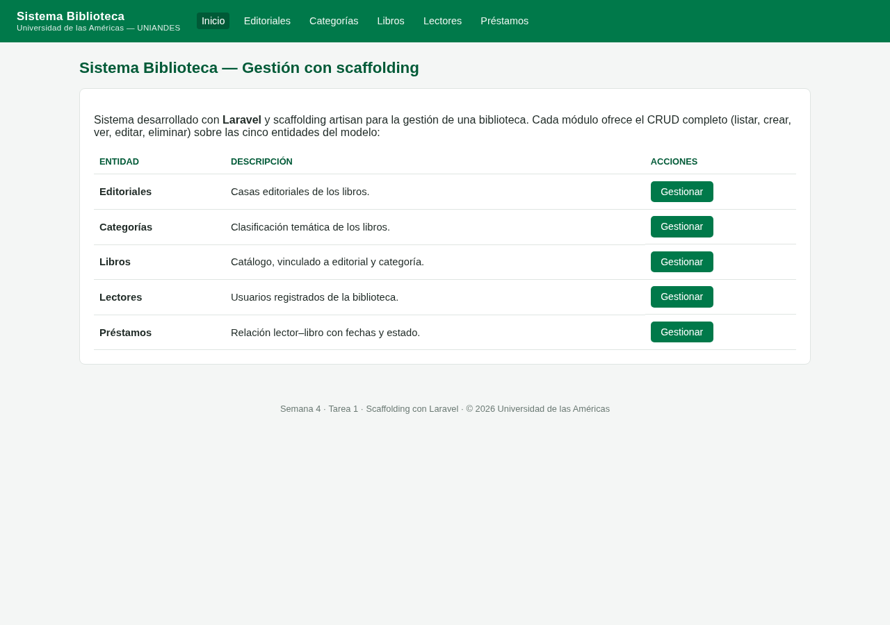
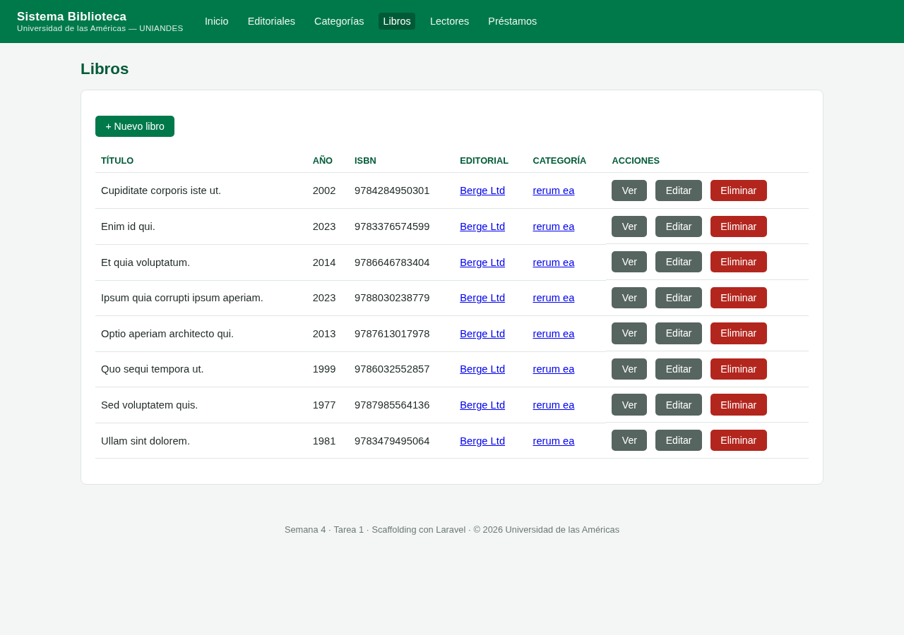

# Semana 4 — Tarea 1: sistema con scaffolding (Laravel + MySQL)

Sistema web de biblioteca construido con **scaffolding de Laravel** (`artisan make:model`, `make:controller --resource`, `make:request`, `make:factory`), según la consigna de la tarea:

> "En base al ejercicio trabajado en clase, tómelo como ejemplo, usted debe generar en la creación de un sistema en donde se contemple en uso de scaffolding. Uno de lo requerimientos es que la base de datos debe tener un máximo de 5 entidades y cada entidad con 5 atributos. Deben tener en cuenta que las entidades deben estar relacionadas entre si."

- **5 entidades** exactas (máximo permitido), **id + 5 atributos de negocio** por entidad (el `id` es adicional al contar los atributos, mismo criterio que la Semana 3 con sus 12 campos).
- **4 relaciones** entre entidades, implementadas con claves foráneas `restrictOnDelete` y relaciones Eloquent en ambos sentidos.

## Ejecutar

Requisitos: Docker y Docker Compose. No requiere PHP ni Composer en el host.

```bash
cd semana4
docker compose up -d --build
```

El arranque es idempotente: instala dependencias, aplica migraciones, siembra datos y levanta el servidor.

| Servicio | Dirección |
| --- | --- |
| Aplicación | <http://127.0.0.1:8082> |
| MySQL 8.4 | `127.0.0.1:3308` (base `semana4`, usuario `semana4`, contraseña `semana4_dev`) |

Los puertos se publican solo en loopback. No levantar simultáneamente los stacks de Semana 2 (8080/3306) y Semana 3 (8081/3307) con otros proyectos que usen puertos distintos; este usa 8082/3308. El volumen `db_datos` conserva los datos en `docker compose down` (sin `-v`).

Detener:

```bash
docker compose down        # conserva los datos
docker compose down -v     # elimina el volumen (pierde los datos)
```

## Las cinco entidades y sus 5 atributos

| Entidad | Atributos (además de `id`) | Relaciones |
| --- | --- | --- |
| `editoriales` | `nombre`, `pais`, `pagina_web`, `fundacion`, `activa` | 1‑N con `libros` |
| `categorias` | `nombre`, `descripcion`, `color`, `orden`, `activa` | 1‑N con `libros` |
| `libros` | `titulo`, `anio`, `isbn`, `editorial_id`, `categoria_id` | N‑1 con `editoriales` y `categorias`; 1‑N con `prestamos` |
| `lectores` | `nombre`, `cedula`, `correo`, `telefono`, `fecha_registro` | 1‑N con `prestamos` |
| `prestamos` | `fecha_prestamo`, `fecha_devolucion`, `estado`, `lector_id`, `libro_id` | N‑1 con `lectores` y `libros` |

Los tipos `timestamps` (`created_at`/`updated_at`) no se crean en estas cinco tablas para respetar el límite de 5 atributos: los modelos declaran `$timestamps = false`.

## Cómo está construido

Todo el artefacto generado por scaffolding vive en `semana4/`:

- **Modelos** (`app/Models/`): `Editorial`, `Categoria`, `Libro`, `Lector`, `Prestamo` con `$fillable`, `casts()` y las relaciones Eloquent (`hasMany`/`belongsTo`) en ambos sentidos.
- **Migraciones** (`database/migrations/`): cinco archivos que crean las tablas con `id` + 5 columnas y claves foráneas `restrictOnDelete`.
- **Controladores resource** (`app/Http/Controllers/`): los cinco, con patrón POST → redirect (PRG), mensajes de éxito/error en sesión y captura de `QueryException` en `destroy` para rechazar el borrado de entidades referenciadas.
- **Form Requests** (`app/Http/Requests/`): `Store*` y `Update*` por entidad (10 en total) con validación de dominio: cédula de 10 dígitos, ISBN de 13 dígitos, correo único, color hex `#RRGGBB`, estado `activo|devuelto`, fechas y existencia de las claves foráneas.
- **Vistas Blade** (`resources/views/`): `layout.blade.php` con la identidad UNIANDES, `home.blade.php` y, por entidad, `index`/`create`/`edit`/`show`/`_form` (26 archivos).
- **Rutas** (`routes/web.php`): `Route::resource` para las cinco entidades más la portada. Se fija el nombre del parámetro con `->parameters([...])` porque el singularizador en inglés produce `lectore`/`editoriale` y el binding implícito por nombre no casaría con los métodos del controlador.
- **Seeders** (`database/seeders/DatabaseSeeder.php`): idempotente; solo crea registros si la tabla está vacía, reutiliza los padres existentes y puede ejecutarse repetidamente sin duplicar datos. Siembra 4 editoriales, 4 categorías, 5 lectores, 8 libros y 6 préstamos.
- **Factories** (`database/factories/`): datos de dominio realistas (ISBN `978…` de 13 dígitos, cédulas de 10 dígitos, teléfonos `09…`).

## Verificar

### Pruebas

La suite corre contra **MySQL** (la base `semana4_test`), no contra SQLite, para verificar el esquema real:

```bash
bash tests/run-tests.sh
```

El script crea la base `semana4_test` si no existe y ejecuta PHPUnit dentro del contenedor (el host no tiene `pdo_mysql`). `tests/bootstrap.php` replica los `<env>` de `phpunit.xml` en `$_SERVER`, que es donde Laravel lee primero las variables de entorno.

Resultado observado: **23 pruebas correctas, 98 aserciones, 0 fallidas**, código de salida 0. [Salida conservada](docs/evidencias/pruebas-phpunit.txt).

Cubre tres grupos:

1. **Estructura** (`DatabaseStructureTest`): existen exactamente las 5 entidades; cada tabla tiene `id` + sus 5 atributos; las 4 claves foráneas están definidas en MySQL.
2. **Relaciones** (`RelationshipsTest`): cada relación funciona en ambos sentidos (editorial ↔ libros, categoría ↔ libros, lector ↔ préstamos, préstamo ↔ lector/libro) y el borrado de una entidad referenciada es rechazado por `restrictOnDelete`.
3. **CRUD HTTP** (`CrudHttpTest`): para cada una de las 5 entidades, el listado, el formulario y el detalle responden 200; `store` crea registros válidos y rechaza los inválidos sin persistir; `update` modifica y rechaza datos inválidos; `destroy` elimina y rechaza eliminar entidades referenciadas.

### Uso del sistema

Levantado el stack, desde <http://127.0.0.1:8082> se recorren los cinco módulos desde la navegación superior. Cada módulo ofrece las cuatro operaciones: **listar**, **crear**, **ver**, **editar** y **eliminar**, con confirmación antes de eliminar y mensajes de éxito/error.

## Evidencias

Capturas reales del stack levantado con `docker compose up`. Los datos visibles son la semilla académica generada por factories, no información privada.

| Evidencia | Archivo |
| --- | --- |
| Portada con navegación de los 5 módulos | [home.png](docs/evidencias/home.png) |
| Listado de editoriales con acciones CRUD | [editoriales.png](docs/evidencias/editoriales.png) |
| Listado de libros con relaciones a editorial y categoría | [libros.png](docs/evidencias/libros.png) |
| Listado de préstamos con lector y libro | [prestamos.png](docs/evidencias/prestamos.png) |
| Formulario de libro con selects de relación | [formulario-libro.png](docs/evidencias/formulario-libro.png) |
| Salida completa de la suite (22/94) | [pruebas-phpunit.txt](docs/evidencias/pruebas-phpunit.txt) |





## Alcance de la entrega

- Migraciones, modelos, factories y seeders de las 5 entidades.
- CRUD completo (5 entidades × 4 operaciones) con validación y vistas con identidad UNIANDES.
- Suite de 23 pruebas automatizadas contra MySQL con evidencia de ejecución.
- Entorno Docker reproducible en 8082/3308.

No incluye autenticación de usuarios, despliegue de producción ni evaluación del docente. La base usa datos de semilla académica.
